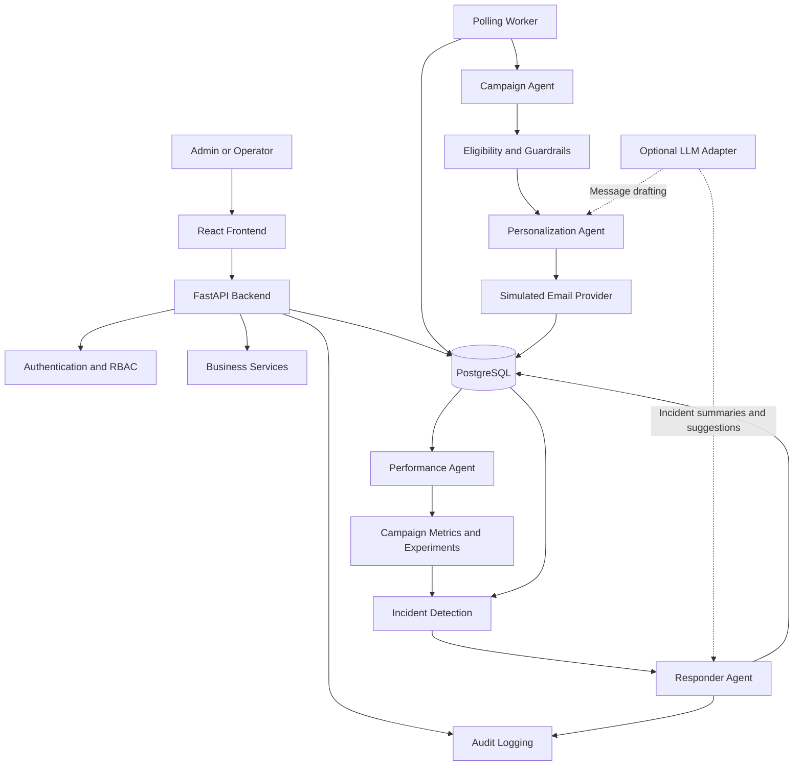

# AI E-commerce Marketing Autopilot — Architecture

**Version:** 1.0  
**Status:** Architecture and implementation baseline  
**Project type:** End-to-end AI marketing automation MVP  
**Primary workflow:** Abandoned-cart recovery  
**Environment:** Local development first, followed by cloud staging  
**Data:** Deterministic synthetic data  
**Core principle:** Build a small, working, testable system before introducing additional complexity.

---

## 1. Project Overview

### 1.1 Objective

Build an AI E-commerce Marketing Autopilot that demonstrates how multiple AI-assisted agents can coordinate abandoned-cart recovery, enforce marketing policies, measure simulated outcomes, detect operational problems, and perform bounded recovery actions.

The system will support three marketing agents and a separate Responder Agent.

The MVP must demonstrate the complete workflow:

1. Identify eligible abandoned carts.
2. Check consent, purchase status, frequency caps, and discount eligibility.
3. Generate an approved recovery message.
4. Simulate email delivery.
5. Record delivery outcomes and purchase attribution.
6. Compare treatment and control groups.
7. Detect operational incidents.
8. Allow the Responder Agent to execute approved recovery actions or escalate to a human.
9. Display metrics, campaign details, incidents, and audit records through a frontend.

### 1.2 Development philosophy

The first priority is to prove that the complete system works locally using synthetic data, automated tests, and simulated marketing outcomes.

The MVP should be affordable to develop and run. It must work without paid services, an OpenAI API key, or real email delivery credentials.

Optional AI integrations can improve message personalization and incident summaries, but deterministic rules and fallback messages must remain available.

### 1.3 Business context

The target business is a general online retail store.

The initial use case is abandoned-cart recovery: customers add products to their carts but do not complete a purchase.

The system attempts to recover eligible carts while respecting marketing consent, message-frequency limits, discount restrictions, and duplicate-send protections.

### 1.4 Autonomy model

The project uses **guarded autonomy**.

AI agents may execute approved actions within explicit rules. Human approval is required for high-risk or ambiguous actions.

No AI agent can override consent requirements, duplicate-send protection, frequency caps, discount limits, or authorization rules.

---

## 2. Scope and Requirements

### 2.1 In scope

- Abandoned-cart recovery workflow.
- Three marketing agents: Campaign, Personalization, and Performance.
- Separate Responder Agent.
- Deterministic business rules and optional LLM assistance.
- Synthetic customer, cart, purchase, and delivery data.
- Simulated email delivery.
- PostgreSQL-backed job state and polling worker.
- Authentication and role-based access control.
- Admin/operator permissions.
- Configurable campaign and alert settings.
- Audit logs and incident history.
- Four frontend pages.
- Automated backend, frontend, integration, and end-to-end tests.
- GitHub Actions CI/CD.
- Cloud staging deployment.
- Health checks, deployment verification, and a demonstrated rollback.

### 2.2 Out of scope for the MVP

- Sending real marketing emails by default.
- Using real customer data.
- Issuing actual coupons or changing live product prices.
- Processing payments.
- Claiming real-world conversion uplift from synthetic experiments.
- Unrestricted autonomous remediation.
- Introducing unnecessary infrastructure such as Redis, a message broker, or multiple independently deployed microservices before they are justified.

---

## 3. Technology Stack

| Component | Technology | Purpose |
|---|---|---|
| Backend API | Python + FastAPI | API endpoints and business logic |
| Python dependency management | uv | Reproducible Python environment |
| Python lockfile | `uv.lock` | Pinned dependency resolution |
| Database | PostgreSQL | Persistent application and worker data |
| ORM | SQLAlchemy | Database models and queries |
| Migrations | Alembic | Version-controlled schema changes |
| Frontend | React + TypeScript | User interface |
| UI styling | Tailwind CSS + shadcn/ui | Consistent responsive interface |
| Charts | Recharts | Dashboard visualizations |
| Frontend dependencies | npm | Package management |
| Frontend lockfile | `package-lock.json` | Reproducible frontend installation |
| Backend testing | pytest + HTTPX | Unit and API tests |
| Database integration testing | PostgreSQL test database | Constraints, transactions, and concurrency |
| Frontend testing | Vitest + React Testing Library | Component and interaction tests |
| Browser testing | Playwright | End-to-end workflow tests |
| Local environment | Docker Compose | Local application and database services |
| CI/CD | GitHub Actions | Automated quality checks and deployment |
| Optional LLM | OpenAI adapter | Constrained message drafting and incident summaries |
| Observability | Structured logs + application metrics | Operational visibility |
| Incident storage | PostgreSQL | Persistent incident and responder history |
| Hosting | Render or a comparable platform | Staging frontend, backend, and database |

Hosting selection must be based on verified pricing, resource limits, database retention, sleep behavior, and worker support before deployment.

### Dependency management rules

- Commit `backend/uv.lock`.
- Commit `frontend/package-lock.json`.
- Exclude `.venv/`, `node_modules/`, build outputs, local secrets, and generated artifacts from Git.
- Use `uv sync --locked` for reproducible backend setup.
- Use `npm ci` for reproducible frontend installation.
- Pin supported runtime versions in project configuration and deployment settings.

---

## 4. High-Level Architecture



### 4.1 Architecture principles

1. **The backend is the source of truth.** The frontend cannot enforce security or business rules by itself.
2. **PostgreSQL stores persistent state.** Campaign execution, job status, incidents, configuration, and audit records must survive application restarts.
3. **Business rules are deterministic.** Eligibility, consent, discount validation, frequency caps, alert thresholds, and permissions must not depend on an LLM.
4. **LLM integration is optional.** The application remains functional when no LLM credentials are configured.
5. **The worker is separate from the API process.** Background processing must continue independently of API request handling.
6. **The MVP is modular, not unnecessarily distributed.** Share backend modules between the API and worker instead of building separate microservices for every agent.
7. **All external side effects are controlled.** Email delivery is simulated by default.
8. **All important actions are auditable.**

---

## 5. Repository Structure

```text
ecommerce-marketing-autopilot/
├── frontend/
│   ├── src/
│   │   ├── api/
│   │   ├── components/
│   │   ├── pages/
│   │   ├── hooks/
│   │   ├── types/
│   │   └── utils/
│   ├── tests/
│   ├── package.json
│   └── package-lock.json
│
├── backend/
│   ├── app/
│   │   ├── api/
│   │   ├── auth/
│   │   ├── agents/
│   │   ├── responder/
│   │   ├── services/
│   │   ├── integrations/
│   │   ├── worker/
│   │   ├── models/
│   │   ├── schemas/
│   │   ├── repositories/
│   │   ├── monitoring/
│   │   └── core/
│   ├── migrations/
│   ├── tests/
│   │   ├── unit/
│   │   ├── api/
│   │   ├── integration/
│   │   └── concurrency/
│   ├── pyproject.toml
│   └── uv.lock
│
├── infra/
│   ├── docker/
│   └── deployment/
│
├── scripts/
│   ├── seed_demo_data.py
│   └── verify_deployment.py
│
├── .github/
│   └── workflows/
│
├── docker-compose.yml
├── Makefile
├── .env.example
├── .gitignore
├── specs.md
├── architecture.md
└── README.md
```

The exact module layout can evolve during implementation, but API, agent, responder, database, and integration responsibilities should remain clearly separated.

---

## 6. Core Components

### 6.1 FastAPI backend

The backend provides REST APIs for:

- Authentication and current-user information.
- Dashboard metrics.
- Campaigns and campaign executions.
- Carts and eligibility decisions.
- Delivery attempts and outcomes.
- Purchase attribution and experiment results.
- Incidents and responder actions.
- Settings and configuration changes.
- User management.
- Audit records.
- Health and readiness checks.

Responsibilities include request validation, authentication, authorization, business-rule enforcement, database transactions, and audit logging.

FastAPI's generated OpenAPI schema will serve as the API contract.

Frontend TypeScript types should be generated from the schema. CI must detect unintended API schema or generated-type drift.

### 6.2 SQLAlchemy and PostgreSQL

Use SQLAlchemy models for database access and Alembic for schema migrations.

Migrations must be version-controlled and tested against an empty PostgreSQL database in CI.

Migrations should run as an explicit deployment step, not automatically when the API or worker starts.

Database constraints should protect critical invariants such as unique idempotency keys and unique campaign executions where appropriate.

### 6.3 Polling worker

The worker finds and processes eligible carts using PostgreSQL-backed job state.

| Setting | Default | Configurable |
|---|---|---|
| Abandoned-cart threshold | 1 hour | Yes |
| Worker polling interval | 60 seconds | Yes |
| Maximum recovery messages per cart | 1 | No policy bypass |
| Customer frequency cap | 1 message per rolling 24 hours | Yes |
| Maximum discount | 5% | Yes |
| Real email delivery | Disabled | Only through explicit configuration |

The worker should:

- Query for eligible work.
- Claim jobs safely.
- Persist processing status and attempt counts.
- Avoid duplicate processing when multiple workers run.
- Retry transient failures within a bounded limit.
- Record failures and reasons.
- Recheck purchase status, consent, previous sends, frequency limits, and discount eligibility immediately before delivery.
- Emit worker heartbeat, processing-lag, and failure metrics.

The 60-second polling interval is a default rather than a guaranteed recovery latency. Actual processing time also depends on worker load and execution duration.

---

## 7. The Three Marketing Agents

### 7.1 Campaign Agent

**Purpose:** Identify eligible abandoned carts and coordinate recovery campaigns.

Responsibilities:

1. Find carts that have passed the abandonment threshold.
2. Check whether a cart has already been processed.
3. Request eligibility validation.
4. Coordinate message personalization.
5. Submit approved messages to the delivery provider.
6. Track campaign outcomes and guardrail rejections.

Example metrics:

- Eligible carts processed.
- Duplicate campaign attempts prevented.
- Campaign processing failures.
- Carts rejected by eligibility rules.

### 7.2 Personalization Agent

**Purpose:** Create an appropriate recovery message.

Responsibilities:

1. Select an approved message strategy.
2. Generate a reminder using deterministic templates by default.
3. Optionally use an LLM to draft a constrained message.
4. Validate generated output.
5. Reject malformed or policy-violating content.
6. Use deterministic fallback messages when the LLM is unavailable or fails.

Example metrics:

- Valid personalization decisions.
- Guardrail compliance.
- Output-validation success.
- Fallback frequency.

The agent cannot decide whether consent is required, waive a frequency cap, authorize an invalid discount, or bypass delivery restrictions.

### 7.3 Performance Agent

**Purpose:** Evaluate campaign delivery, purchases, attribution, and experimental outcomes.

Responsibilities:

1. Aggregate delivery and purchase events.
2. Calculate attributed purchases and revenue.
3. Calculate treatment and control conversion rates.
4. Estimate incremental performance.
5. Detect data-quality problems.
6. Produce evidence-based optimization recommendations.

Example metrics:

- Attribution calculation accuracy.
- Treatment/control reporting accuracy.
- Measurement data completeness.
- Valid optimization recommendations.

The agent must distinguish attributed purchases from estimated incremental uplift. Attribution alone does not establish causation.

---

## 8. Responder Agent

The Responder Agent is separate from the three marketing agents. It responds to operational incidents using explicit rules, measured evidence, and an allowlist of permitted actions.

### 8.1 Operating process

1. Receive an incident or alert.
2. Gather supporting evidence from metrics, logs, jobs, and delivery events.
3. Classify the incident.
4. Determine whether a predefined action is permitted.
5. Execute an authorized low-risk action or request human approval.
6. Verify the outcome.
7. Record the action and result.
8. Escalate if recovery fails or the situation remains ambiguous.

### 8.2 Automatically permitted actions

Subject to explicit deterministic rules, the responder may:

- Retry transient delivery failures within configured limits.
- Retry eligible failed jobs.
- Check worker health.
- Pause a campaign when a predefined incident rule requires it.
- Verify recovery and resolve an incident when recovery is confirmed.

### 8.3 Actions requiring human approval

- Resuming a campaign paused because of a serious incident.
- Changing high-risk configuration.
- Performing remediation with uncertain consequences.
- Taking actions outside the responder's allowlist.
- Handling ambiguous or unresolved incidents.

### 8.4 Mandatory restrictions

The responder cannot:

- Override marketing consent.
- Bypass duplicate-send protection.
- Bypass customer frequency caps.
- Exceed the maximum discount.
- Disable authentication or authorization.
- Delete or bypass audit history.
- Grant itself additional permissions.
- Treat an LLM suggestion as authorization.

LLMs may summarize evidence and recommend actions, but they cannot authorize their own actions or independently execute high-risk remediation.

### 8.5 Audit requirements

Each responder action records:

- Incident identifier.
- Trigger and evidence.
- Decision and reason.
- Authorization or approval status.
- Action attempted.
- Action result.
- Retry count, where applicable.
- Escalation and resolution status.
- Timestamp.

---

## 9. Guardrails and Business Rules

### 9.1 Abandoned-cart eligibility

A cart becomes eligible after the configured abandonment threshold, defaulting to one hour.

Before sending, the backend must confirm that:

- The cart still exists and remains eligible.
- The customer has not completed a purchase that invalidates the recovery.
- Marketing email consent is present.
- No recovery message has already been sent for that cart.
- The customer has not exceeded the rolling 24-hour marketing frequency cap.
- Any proposed incentive satisfies the discount policy.

### 9.2 Consent

Marketing email consent is mandatory.

Customers without consent must be suppressed from marketing delivery. The system records the suppression reason.

Consent is rechecked immediately before delivery, even if it was valid when the cart was first identified.

Neither an agent nor an administrator may use the campaign workflow to bypass the mandatory consent check.

### 9.3 Duplicate-send prevention

At most one recovery message may be sent per cart.

Protection must exist at multiple layers:

- Campaign eligibility checks.
- Backend idempotency keys.
- Database uniqueness constraints where appropriate.
- Transactional state changes.
- A final pre-delivery check.
- Concurrency tests covering multiple workers.

A duplicate-send attempt should be recorded and can trigger an incident.

### 9.4 Frequency cap

Default policy: at most one marketing message per customer per rolling 24-hour period.

The value is configurable by an administrator.

The backend must enforce the limit atomically so two concurrent jobs cannot both pass the same frequency check and send separate messages.

### 9.5 Discount cap

Default maximum discount: 5%.

The backend must validate discount eligibility and any configured minimum order value.

Discounts and coupon codes are simulated in the MVP. The application must not issue real coupons or modify real prices.

### 9.6 Configuration security

High-risk settings can only be changed by administrators.

Every configuration change must be validated and audited, including the setting name, old value, new value, actor, and timestamp.

Invalid configuration must be rejected by the backend, not merely hidden or disabled in the frontend.

---

## 10. Synthetic Data and Experiment Measurement

### 10.1 Dataset

Create a deterministic synthetic dataset of approximately 100 customers and carts.

Include examples of:

- Customers with marketing consent.
- Customers without consent.
- Abandoned carts.
- Carts that have already been purchased.
- Carts that are not yet eligible.
- Previously processed carts.
- Customers who have reached their frequency cap.
- Eligible and ineligible discount scenarios.
- Successful delivery.
- Transient delivery failure.
- Repeated delivery failure.
- Treatment and control assignments.
- Duplicate-send attempts.
- Conversion degradation and other alert scenarios.

A deterministic seed should make test outcomes reproducible.

### 10.2 Simulated email provider

Use a provider interface with a simulated implementation as the default.

The simulator should support:

- Successful delivery.
- Transient failures.
- Permanent failures.
- Retry attempts.
- Delivery status recording.
- Duplicate-attempt scenarios.

Real delivery must remain disabled unless explicitly configured. Tests must never accidentally send real emails.

### 10.3 Attribution and control group

Use a 24-hour attribution window and a randomized eligible control group.

Report:

- Treatment-group sample size.
- Control-group sample size.
- Treatment conversion rate.
- Control conversion rate.
- Attributed purchases and revenue.
- Estimated incremental uplift.
- Absolute percentage-point difference.
- Relative percentage difference.

Attributed outcomes and estimated incremental uplift must be presented separately.

All synthetic results, charts, and dashboard metrics must be labelled **Simulated**.

The system must not claim that synthetic data demonstrates actual business performance. A minimum sample size alone does not establish statistical significance.

---

## 11. Alerting and Monitoring

### 11.1 Delivery-failure alert

Trigger an alert when more than 20% of delivery attempts fail in a rolling five-minute window, provided the window contains at least 10 attempts.

Examples:

| Attempts | Failures | Failure rate | Result |
|---:|---:|---:|---|
| 10 | 3 | 30% | Trigger |
| 10 | 2 | 20% | Do not trigger |
| 20 | 5 | 25% | Trigger |
| 8 | 4 | 50% | Do not trigger; insufficient attempts |

The minimum-attempt rule prevents a very small number of failures from immediately triggering this particular alert.

### 11.2 Conversion-degradation alert

Default settings:

- Relative decline threshold: 20%.
- Minimum treatment-group sample size: 50 observations.
- Both settings are configurable by an administrator.

The system must:

1. Validate configuration values.
2. Record changes in the audit log.
3. Define the baseline consistently.
4. Check the sample-size requirement before evaluating the alert.
5. Calculate the relative decline correctly.
6. Record evidence supporting the alert.
7. Avoid claiming statistical significance solely because the threshold is crossed.

For example, if baseline conversion is 10%, a 20% relative decline means conversion falls to 8% or lower. This is a decline of 2 percentage points, not 20 percentage points.

### 11.3 Duplicate-send-attempt alert

Detect attempts to send a recovery message more than once for the same cart.

The system must preserve duplicate prevention even if alert creation fails. Alerting is not the mechanism that prevents duplicate sends.

### 11.4 Technical and business monitoring

Monitor technical health:

- API availability.
- API latency.
- Database errors.
- Worker heartbeat.
- Worker processing lag.
- Job failures and retries.

Monitor business behavior:

- Delivery failure rates.
- Conversion degradation.
- Duplicate-send attempts.
- Guardrail rejections.
- Recovery outcomes.
- Attribution and experiment results.

### 11.5 Observability implementation

Use structured application logs, Prometheus-compatible application metrics, health endpoints, and PostgreSQL-backed incidents.

This provides useful monitoring without requiring a paid monitoring service for the MVP.

---

## 12. Frontend Design

The frontend uses React, TypeScript, Tailwind CSS, shadcn/ui, and Recharts.

The application contains four focused pages.

### 12.1 Dashboard

Display:

- Recovery rate.
- Attributed revenue.
- Estimated incremental uplift.
- Delivery success rate.
- Treatment versus control conversion.
- Active campaigns.
- Open incidents.
- Recent activity.

Include charts for:

- Recovery trends.
- Delivery outcomes.
- Treatment versus control conversion.

All metrics must come from backend calculations and be clearly labelled as simulated.

### 12.2 Campaigns

Display:

- Campaign status.
- Eligible carts.
- Processing outcomes.
- Delivery attempts.
- Guardrail rejections.
- Message decisions.
- Purchase attribution.
- Related incidents and audit records.

### 12.3 Incidents

Display:

- Delivery-failure incidents.
- Conversion-degradation incidents.
- Duplicate-send-attempt incidents.
- Incident status and evidence.
- Event timeline.
- Responder decisions and actions.
- Retry history.
- Escalation and resolution details.

Provide links to related campaigns, delivery events, and audit records.

### 12.4 Settings and Audit

Display:

- Configurable abandonment threshold.
- Worker polling interval.
- Customer frequency cap.
- Maximum discount.
- Conversion-degradation threshold.
- Conversion-alert minimum sample size.
- User management for administrators.
- Searchable audit records.

Only administrators may change high-risk settings or manage users. Operators can view audit history but cannot change high-risk configuration.

---

## 13. Authentication and Authorization

Use email/password login with secure password hashing and protected API routes.

Sessions or tokens must expire appropriately. Use secure cookie and CSRF protections where applicable.

Secrets must be stored in environment variables or the hosting provider's secret manager. Passwords, tokens, and secret values must never be written to logs.

### 13.1 Admin role

Administrators may:

- View all four frontend pages.
- View campaign and experiment metrics.
- Investigate incidents.
- View audit records.
- Manage campaigns within the same safety constraints.
- Change high-risk configuration.
- Create, disable, and manage operator accounts.

### 13.2 Operator role

Operators may:

- View the dashboard.
- View campaigns.
- Investigate incidents.
- View audit history.
- Perform explicitly permitted campaign and incident actions.

Operators may not:

- Manage users.
- Change high-risk settings.
- Bypass consent.
- Bypass duplicate-send prevention.
- Bypass frequency caps.
- Exceed discount limits.

### 13.3 Enforcement

Authorization must be checked by the backend on every protected action.

Hiding a frontend button is not sufficient authorization.

---

## 14. Database Model

The initial schema should contain the following conceptual entities. Exact columns and relationships should be finalized during implementation planning.

| Entity | Purpose |
|---|---|
| User | Login identity and account status |
| Role | Admin or operator permissions |
| Customer | Synthetic customer profile |
| MarketingConsent | Consent status and relevant timestamps |
| Cart | Cart state and abandonment timestamps |
| CartItem | Products and quantities in a cart |
| Campaign | Campaign configuration and status |
| CampaignExecution | Recovery workflow state for a cart |
| ExperimentAssignment | Treatment/control assignment |
| PersonalizationDecision | Chosen strategy and validated message |
| DeliveryAttempt | Simulated email attempt and outcome |
| Purchase | Synthetic purchase event |
| AttributionRecord | Purchase attribution within the defined window |
| Job | Persistent worker task and processing status |
| IdempotencyRecord | Deduplication of important processing operations |
| Incident | Alert, evidence, status, and resolution |
| ResponderAction | Proposed and executed incident actions |
| AppSetting | Validated configurable settings |
| AuditEvent | Security, configuration, and business-action history |

### Database requirements

- Use migrations for every schema change.
- Add indexes for common queries.
- Add uniqueness constraints for idempotency and other critical invariants.
- Use transactions for operations that must succeed or fail together.
- Test concurrent workers against a real PostgreSQL test database.
- Keep incident and audit history persistent.
- Do not assume that every database migration can be automatically rolled back safely.

---

## 15. LLM Integration and Fallback Strategy

The LLM is an optional provider behind a defined interface.

### 15.1 Allowed uses

- Drafting personalized recovery messages within approved constraints.
- Summarizing incident evidence.
- Suggesting low-risk remediation for human review.

### 15.2 Disallowed uses

- Authorizing messages without backend checks.
- Overriding consent or frequency caps.
- Choosing discounts beyond the permitted limit.
- Authorizing its own responder actions.
- Executing high-risk actions without required approval.

### 15.3 Failure handling

Handle:

- Missing API credentials.
- Provider timeouts.
- Rate limits.
- Provider errors.
- Malformed structured output.
- Invalid or policy-violating messages.

Use deterministic message templates and rule-based incident handling whenever the LLM is unavailable or its output fails validation.

### 15.4 Cost controls

- Do not call the LLM for deterministic eligibility checks.
- Set request timeouts.
- Limit prompt and response tokens.
- Use an optional spending limit.
- Minimize customer information sent to external providers.
- Mock LLM responses during tests.
- Keep the core workflow functional without external AI calls.

---

## 16. Failure Handling and Reliability

The system must fail safely.

### 16.1 Delivery failures

- Retry transient failures within a bounded limit.
- Record each attempt.
- Avoid repeating successful sends.
- Escalate persistent failures.
- Keep the campaign and incident status consistent.

### 16.2 Worker failures

- Persist job state in PostgreSQL.
- Record attempt counts and failure reasons.
- Allow eligible jobs to be retried.
- Prevent concurrent workers from sending duplicate messages.
- Expose worker heartbeat and processing-lag metrics.

### 16.3 LLM failures

- Fall back to deterministic templates.
- Reject invalid output.
- Never bypass backend guardrails.
- Record relevant failure information without logging secrets.

### 16.4 Responder failures

- Stop automatic retries when the configured limit is reached.
- Record the failure.
- Escalate unresolved incidents.
- Require human approval for ambiguous or high-risk recovery.
- Never assume an action succeeded without verifying the result.

---

## 17. Testing Strategy

Testing is a mandatory part of the implementation, not a final optional step.

### 17.1 Backend unit tests

Test:

- Cart eligibility.
- Consent validation.
- Frequency-cap calculation.
- Discount validation.
- Duplicate-send prevention.
- Attribution calculation.
- Experiment metrics.
- Alert thresholds.
- Sample-size checks.
- Configuration validation.
- Responder authorization rules.
- Deterministic fallback behavior.

### 17.2 API tests

Use pytest and HTTPX to test:

- Login and authentication.
- Role-based permissions.
- Request validation.
- Error handling.
- Campaign endpoints.
- Incident endpoints.
- Settings endpoints.
- Audit endpoints.
- User-management endpoints.

### 17.3 PostgreSQL integration tests

Use a real PostgreSQL test database to verify:

- Alembic migrations from an empty database.
- Database constraints.
- Transactional behavior.
- Persistent job state.
- Idempotency.
- Concurrent processing.
- Duplicate-send prevention.
- Atomic frequency-cap enforcement.

SQLite-only testing is insufficient for the critical concurrency and PostgreSQL-specific behavior.

### 17.4 Frontend tests

Use Vitest and React Testing Library to test:

- Rendering of all four pages.
- Loading and error states.
- User interactions.
- Role-based UI behavior.
- Settings validation.
- Incident actions.
- Simulated-data labels.

### 17.5 End-to-end tests

Use Playwright to verify workflows such as:

1. Log in as an administrator.
2. View dashboard metrics.
3. Open a campaign.
4. Inspect an eligible cart.
5. Process a recovery message through simulated delivery.
6. Confirm that the delivery result is recorded.
7. Verify attribution and experiment metrics.
8. Trigger a simulated incident.
9. Inspect the responder action.
10. Confirm audit history.
11. Verify that operators cannot access administrator-only operations.

### 17.6 Quality gates

- All required tests must pass.
- Backend and frontend linting must pass.
- Type checking must pass.
- API schema validation must pass.
- Migration checks must pass.
- Critical business logic must achieve at least 90% test coverage.
- CI must block merging and deployment when a required check fails.

Coverage percentage is a target for critical business logic, not a substitute for meaningful boundary, integration, and concurrency tests.

---

## 18. Local Development

Develop locally first, using GitHub Codespaces where convenient.

Docker Compose should make the backend and PostgreSQL database easy to start together. The frontend may run as a separate development process.

### Initial setup objectives

1. Create the repository and configuration files.
2. Configure the Python environment using `uv`.
3. Configure the React/TypeScript frontend using npm.
4. Start PostgreSQL.
5. Configure database connectivity.
6. Run Alembic migrations.
7. Seed deterministic synthetic data.
8. Start the FastAPI application.
9. Start the polling worker.
10. Start the frontend.
11. Run the tests.
12. Verify the complete workflow locally.

Use `.env.example` to document required environment variable names. Do not commit real secrets or local environment files.

---

## 19. CI/CD with GitHub Actions

### 19.1 Pull request checks

Every pull request must run the required quality gates:

- Backend dependency and lockfile validation.
- Backend linting and type checking.
- Backend unit tests.
- PostgreSQL integration tests.
- Migration tests from an empty database.
- Critical-logic coverage checks.
- Frontend installation with `npm ci`.
- Frontend linting and type checking.
- Frontend tests.
- API schema/type drift validation.
- Playwright end-to-end tests for critical workflows where practical.

### 19.2 Branch protection

Protect the `main` branch.

Changes may merge only after required CI checks pass and the repository's review requirements are satisfied.

### 19.3 Staging deployment

After a successful merge to `main`:

1. Build versioned application artifacts.
2. Deploy the frontend and backend to staging.
3. Apply database migrations as an explicit step.
4. Run health and readiness checks.
5. Verify database connectivity.
6. Verify worker heartbeat.
7. Run critical smoke tests.
8. Record deployment status and version.

### 19.4 Production approval

Production deployment must require manual approval.

Production infrastructure and real delivery integrations should be considered only after staging acceptance and cost verification.

---

## 20. Deployment Architecture

Deploy three primary components:

1. **Frontend:** React static site.
2. **Backend:** FastAPI web service.
3. **Database:** PostgreSQL.

The polling worker runs as a separate process or supported background service, sharing the backend application package and PostgreSQL database.

A platform such as Render may be suitable, but current service costs, free-tier limitations, worker support, database persistence, and sleep behavior must be verified before committing to a deployment design.

### 20.1 Deployment verification

Verify:

- Frontend can communicate with the backend.
- Authentication works.
- Admin and operator permissions are enforced.
- Database migrations are applied.
- Health endpoints respond correctly.
- Worker heartbeat is visible.
- Jobs are processed.
- Simulated recovery works end to end.
- Consent and duplicate-send protections remain active.
- Incidents and audit records are persisted.

### 20.2 Rollback strategy

Demonstrate rollback using a known-good prior application version or image.

The rollback procedure must:

1. Identify the previous known-good version.
2. Deploy that version.
3. Verify API and frontend health.
4. Verify database connectivity.
5. Verify worker health.
6. Execute a critical smoke test.
7. Record the result.

Database rollback must be treated separately from application rollback.

Prefer backward-compatible migrations. For destructive or irreversible schema changes, use a documented forward-fix or backup-and-restore strategy rather than assuming an automatic reverse migration is safe.

---

## 21. Staging Acceptance Criteria

The project is accepted in staging only when all required checks pass.

### Functional requirements

- [ ] Dashboard displays the required metrics and charts.
- [ ] Campaigns page displays campaign execution and delivery outcomes.
- [ ] Incidents page displays evidence, timelines, and responder actions.
- [ ] Settings and Audit page supports authorized configuration and audit review.
- [ ] All three marketing agents complete their assigned responsibilities.
- [ ] The Responder Agent handles permitted actions and escalates appropriately.
- [ ] The synthetic abandoned-cart workflow completes end to end.
- [ ] Purchase attribution and treatment/control reporting work correctly.

### Safety and security

- [ ] Consent is required before delivery.
- [ ] Consent is rechecked immediately before sending.
- [ ] No cart receives more than one recovery message.
- [ ] Frequency caps are enforced atomically.
- [ ] Discount limits are enforced by the backend.
- [ ] Admin/operator permissions are enforced on protected API operations.
- [ ] High-risk configuration changes are validated and audited.
- [ ] The responder cannot bypass safety policies.
- [ ] Secrets are not committed or written to logs.
- [ ] Real email delivery is disabled by default.

### Monitoring and recovery

- [ ] Delivery-failure alert threshold is tested.
- [ ] Conversion-degradation threshold and minimum sample are tested.
- [ ] Duplicate-send attempts are detected and recorded.
- [ ] Worker health and failure metrics are available.
- [ ] Responder actions are recorded.
- [ ] Failed recovery is escalated.
- [ ] Incident resolution is verified rather than assumed.

### Quality and operations

- [ ] Backend tests pass.
- [ ] Frontend tests pass.
- [ ] PostgreSQL integration and concurrency tests pass.
- [ ] Playwright critical workflows pass.
- [ ] Critical business logic has at least 90% test coverage.
- [ ] API schema and frontend types remain consistent.
- [ ] Database migrations pass CI checks.
- [ ] Required CI checks block merges when they fail.
- [ ] Staging health checks and deployment verification pass.
- [ ] A rollback is demonstrated and verified.
- [ ] Synthetic outcomes are labelled clearly.
- [ ] No real marketing messages are sent by default.

---

## 22. Implementation Plan

Implement the project in small, verifiable stages. Do not build all agents, pages, and infrastructure before the first complete workflow works.

### Phase 1 — Repository and environment

- Set up the monorepo.
- Configure `uv` and npm.
- Add Docker Compose and PostgreSQL.
- Add environment templates and Git ignore rules.
- Create basic FastAPI and React applications.
- Add initial CI checks.

**Exit condition:** The applications start locally and can connect to PostgreSQL.

### Phase 2 — Database and synthetic data

- Implement SQLAlchemy models.
- Add Alembic migrations.
- Create deterministic seed data.
- Add health and readiness endpoints.
- Add migration tests.

**Exit condition:** A clean database can be migrated and seeded reproducibly.

### Phase 3 — Authentication, roles, and audit

- Implement login.
- Add secure password hashing.
- Add admin/operator permissions.
- Protect API routes.
- Implement audit logging.
- Add settings validation.

**Exit condition:** Protected endpoints enforce permissions and important changes are audited.

### Phase 4 — Guardrails and core workflow

- Implement cart eligibility.
- Implement consent checks.
- Implement frequency caps.
- Implement discount validation.
- Implement idempotency and duplicate-send prevention.
- Implement simulated delivery.

**Exit condition:** One synthetic cart can complete a safe recovery workflow without duplicate delivery.

### Phase 5 — Polling worker

- Add PostgreSQL-backed job state.
- Implement the configurable polling loop.
- Add safe job claiming and bounded retries.
- Add worker heartbeat and failure metrics.
- Add concurrency tests.

**Exit condition:** Eligible jobs are processed reliably and duplicate sends are prevented under concurrent processing.

### Phase 6 — Marketing agents

- Implement Campaign Agent.
- Implement Personalization Agent using deterministic templates.
- Implement Performance Agent.
- Add attribution and experiment calculations.
- Add agent metrics.

**Exit condition:** The three agents complete their responsibilities using deterministic behavior.

### Phase 7 — Incidents and Responder Agent

- Implement delivery-failure alerts.
- Implement conversion-degradation alerts.
- Implement duplicate-send-attempt alerts.
- Implement responder allowlists.
- Implement retries, pause rules, escalation, and verification.
- Record all responder actions.

**Exit condition:** Simulated incidents trigger correctly and recovery actions respect authorization boundaries.

### Phase 8 — Frontend

- Build the Dashboard.
- Build the Campaigns page.
- Build the Incidents page.
- Build the Settings and Audit page.
- Integrate generated TypeScript API types.
- Add Recharts visualizations.
- Clearly label simulated data.

**Exit condition:** Users can inspect and operate the MVP through the four pages with correct role-based access.

### Phase 9 — Testing and quality gates

- Complete backend unit tests.
- Complete API and PostgreSQL integration tests.
- Add concurrency tests.
- Complete frontend tests.
- Add Playwright end-to-end tests.
- Enforce the 90% critical-logic coverage target.
- Add schema drift and migration checks to CI.

**Exit condition:** All required checks pass and failures block merging.

### Phase 10 — Optional LLM integration

- Add the optional LLM adapter.
- Implement constrained message drafting.
- Implement incident summarization.
- Add timeouts, output validation, and cost controls.
- Test missing credentials and provider failures.
- Confirm deterministic fallbacks work.

**Exit condition:** Optional AI enhancements improve the workflow without becoming a required dependency or weakening safety controls.

### Phase 11 — Staging and rollback

- Verify hosting costs and platform capabilities.
- Deploy the frontend, backend, database, and worker.
- Apply migrations explicitly.
- Run health checks and smoke tests.
- Verify all safety and incident workflows.
- Demonstrate rollback.
- Document operational limitations.

**Exit condition:** Every staging acceptance criterion passes.

---

## 23. Final Design Principles

1. Build the smallest end-to-end vertical slice first.
2. Use synthetic data until the workflow and safety rules are reliable.
3. Make deterministic business logic the authority for eligibility, sending, measurement, and remediation.
4. Keep LLMs optional and constrained.
5. Enforce safety rules in the backend and database.
6. Use PostgreSQL-backed job state and idempotency.
7. Record important actions and failures in persistent audit and incident history.
8. Test concurrency, boundaries, and failure paths—not only successful requests.
9. Use CI as a mandatory quality gate.
10. Verify hosting costs and limitations before deployment.
11. Demonstrate rollback rather than merely documenting an untested procedure.
12. Clearly distinguish simulated campaign outcomes from real business results.

**First end-to-end milestone:** A synthetic abandoned cart passes eligibility checks, receives a deterministic recovery message through simulated delivery, produces recorded delivery and attribution events, appears in the dashboard, and leaves a complete audit trail. Build and test this workflow before expanding the system.
