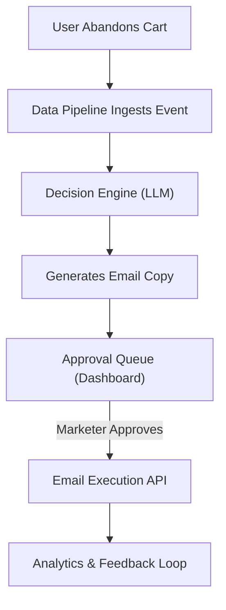

## 1. Product Overview
The AI-Driven Autonomous Marketing Automation System is a comprehensive platform designed for E-commerce businesses. It aims to reduce manual marketing workloads and increase revenue through highly personalized, automated campaigns like abandoned cart recovery and lifecycle management. The platform features an AI decision engine, real-time analytics, and a human-in-the-loop approval system.

- **Primary Purpose**: Automate audience segmentation, content generation, and trigger-based messaging.
- **Target Value**: Incremental Revenue per Recipient (RPR), improved conversion rates, and significant reduction in manual setup time.

## 2. Core Features

### 2.1 User Roles
| Role | Registration Method | Core Permissions |
|------|---------------------|------------------|
| Marketer/Admin | System provisioned | View dashboard, approve/reject AI campaigns, configure agents, view analytics |

### 2.2 Feature Module
1. **Dashboard**: High-level metrics (RPR, open rates), recent AI activities, active agents status.
2. **Agent Management**: Configuration for Abandoned Cart, Lifecycle, and Creative Testing agents.
3. **Approval Queue**: Human-in-the-loop interface to review, edit, approve, or reject AI-generated emails.
4. **Analytics**: Detailed view of campaign performance and A/B test results.

### 2.3 Page Details
| Page Name | Module Name | Feature description |
|-----------|-------------|---------------------|
| Dashboard | Overview Metrics | Displays North Star metrics (RPR, Conversion Rate, Alert Status) |
| Dashboard | Active Agents | List of running agents (Abandoned Cart, Lifecycle) with health status |
| Approvals | Review Queue | List of pending AI-generated emails awaiting human review |
| Approvals | Detail View | Side-by-side view of trigger context (e.g., cart items) and generated copy |
| Analytics | Performance | Charts showing open rates, CTR, and revenue over time |

## 3. Core Process
The marketer logs in to monitor the system. When an event (e.g., cart abandoned) occurs, the backend AI Agent generates an email and places it in the Approval Queue. The marketer reviews and approves it, triggering the execution.

## 4. User Interface Design
### 4.1 Design Style
- **Primary Colors**: Midnight Blue (#0F172A) and Indigo (#4F46E5) for a professional, trustworthy tech vibe.
- **Secondary Colors**: Emerald Green (#10B981) for success/revenue, Rose (#E11D48) for alerts/warnings.
- **Button Style**: Clean, slightly rounded (rounded-md), with subtle hover transitions and focus rings.
- **Font**: 'Inter' or a modern sans-serif like 'Geist' for clean, readable data presentation.
- **Layout**: Sidebar navigation with a spacious, card-based main content area. Data-dense but breathable.

### 4.2 Page Design Overview
| Page Name | Module Name | UI Elements |
|-----------|-------------|-------------|
| Dashboard | Metrics Cards | Large typography for numbers, sparkline charts, status indicators |
| Approvals | Review Queue | Table layout with status badges, split-pane for quick review |

### 4.3 Responsiveness
Desktop-first design, optimized for complex data tables and split-pane views, but mobile-adaptive for quick approvals on the go.
