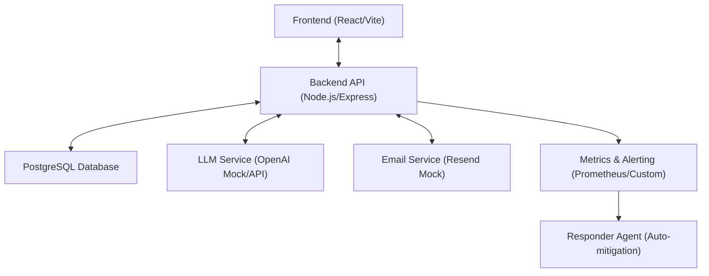
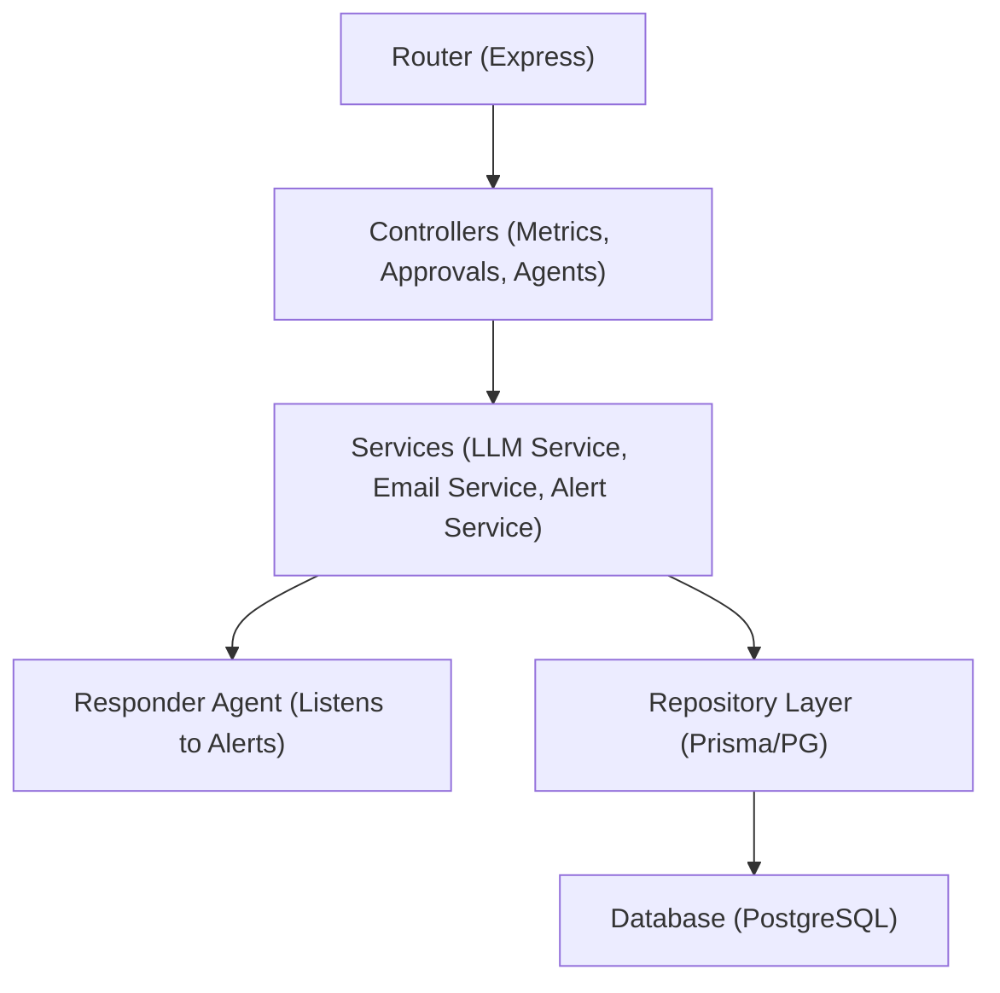
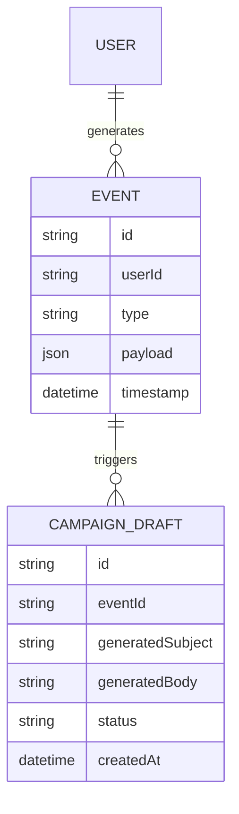

## 1. Architecture Design


## 2. Technology Description
- **Frontend**: React@18 + TailwindCSS + Vite
- **Backend**: Node.js + Express (TypeScript)
- **Database**: PostgreSQL (using Prisma or raw pg for queries)
- **Testing**: Vitest (Unit/Integration), React Testing Library (Frontend)
- **Containerization**: Docker & Docker Compose
- **CI/CD**: GitHub Actions workflow (Build, Test, Deploy, Rollback)
- **Observability**: Custom metrics endpoint tracking business/user impact (e.g., failed email sends, drop in RPR) rather than just CPU/Memory.

## 3. Route Definitions (Frontend)
| Route | Purpose |
|-------|---------|
| `/` | Dashboard home with key metrics |
| `/approvals` | Human-in-the-loop email review queue |
| `/agents` | Configuration and status of AI agents |

## 4. API Definitions (Backend)
```typescript
// GET /api/metrics
// Returns high-level KPIs and system health
interface MetricsResponse {
  rpr: number;
  conversionRate: number;
  pendingApprovals: number;
  alertStatus: 'ok' | 'warning' | 'critical';
}

// GET /api/approvals
// Returns list of pending AI-generated campaigns
interface ApprovalItem {
  id: string;
  triggerEvent: string;
  userContext: object;
  generatedSubject: string;
  generatedBody: string;
  status: 'pending' | 'approved' | 'rejected';
}

// POST /api/approvals/:id/approve
// Approves an email and triggers sending
```

## 5. Server Architecture Diagram


## 6. Data Model
### 6.1 Data Model Definition


### 6.2 Data Definition Language
```sql
CREATE TABLE users (
    id UUID PRIMARY KEY DEFAULT gen_random_uuid(),
    email VARCHAR(255) UNIQUE NOT NULL,
    created_at TIMESTAMP DEFAULT CURRENT_TIMESTAMP
);

CREATE TABLE events (
    id UUID PRIMARY KEY DEFAULT gen_random_uuid(),
    user_id UUID REFERENCES users(id),
    type VARCHAR(50) NOT NULL, -- e.g., 'cart_abandoned'
    payload JSONB,
    timestamp TIMESTAMP DEFAULT CURRENT_TIMESTAMP
);

CREATE TABLE campaign_drafts (
    id UUID PRIMARY KEY DEFAULT gen_random_uuid(),
    event_id UUID REFERENCES events(id),
    generated_subject TEXT NOT NULL,
    generated_body TEXT NOT NULL,
    status VARCHAR(20) DEFAULT 'pending', -- pending, approved, rejected
    created_at TIMESTAMP DEFAULT CURRENT_TIMESTAMP
);
```